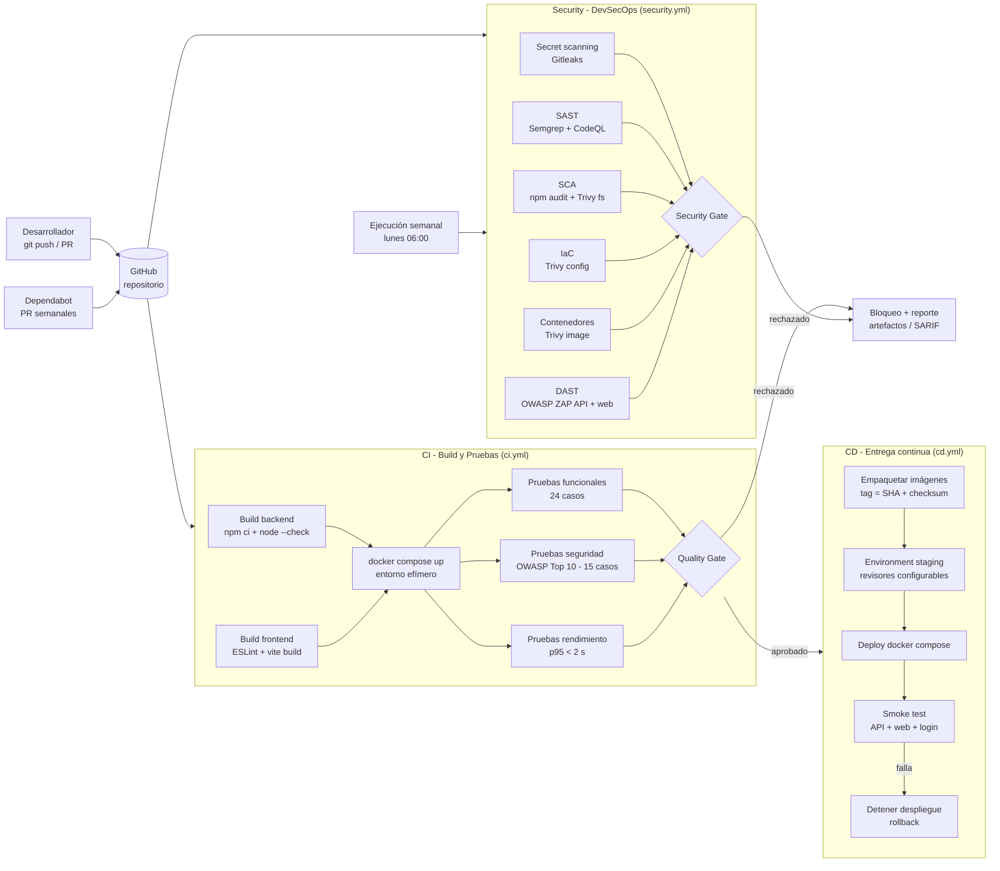

# Integración CI/CD y DevSecOps — Cuidarte+

Este documento describe los pipelines que se agregaron al proyecto Cuidarte+ (ISY1102).
**El código de la aplicación no se modificó**: las pipelines buscan los defectos,
los miden y los reportan. Cada hallazgo queda como evidencia en los artefactos de
GitHub Actions y en el resumen de cada ejecución.

## 1. Archivos agregados

| Archivo | Propósito |
|---|---|
| `.github/workflows/ci.yml` | Integración continua: build, análisis estático (ESLint), pruebas funcionales, de seguridad y de rendimiento, y Quality Gate |
| `.github/workflows/security.yml` | Pruebas de seguridad automatizadas (DevSecOps): Gitleaks, Semgrep, CodeQL, npm audit, Trivy, OWASP ZAP y Security Gate |
| `.github/workflows/cd.yml` | Entrega continua: empaqueta imágenes etiquetadas con el SHA del commit (artefacto con checksum SHA-256) y despliega en staging con smoke test |
| `.github/dependabot.yml` | Mantenimiento: actualizaciones semanales de dependencias, imágenes base y acciones |
| `.gitleaks.toml` | Configuración del escáner de secretos |
| `deploy/docker-compose.staging.yml` | Override para desplegar las imágenes publicadas (sin reconstruirlas) |
| `tests/api/*.test.mjs` | Pruebas automatizadas de caja negra (sin dependencias externas: `node:test` + `fetch`) |

## 2. Diagrama del pipeline con controles de seguridad automatizados



## 3. Enfoques y herramientas de prueba de seguridad

| Enfoque | Herramienta | Cuándo se ejecuta | Qué detecta en Cuidarte+ (ejemplos) |
|---|---|---|---|
| **Secret scanning** | Gitleaks (todo el historial git) | push, PR, semanal | `JWT_SECRET` en `.env`, `BACKEND/.env` y `README.md` |
| **SAST** (análisis estático) | Semgrep (OWASP Top 10, nodejsscan, express, react, jwt), CodeQL `security-extended` | push, PR, semanal | Semgrep: comparación de contraseña vulnerable a *timing attack* (`auth.js:21`), XSS reflejado (`documentos.js:206`), escritura directa de archivo (`documentos.js:252`), contenedores sin `USER`; CodeQL: 32 rutas sin *rate limiting* |
| **SCA** (dependencias) | `npm audit`, Trivy fs | push, PR, **semanal** (CVE nuevas sin cambios de código) | backend: 10 vulnerabilidades (1 crítica, 7 altas, 2 moderadas); frontend: 24 (17 altas, 6 moderadas, 1 baja); `multer` 1.x obsoleto |
| **IaC / configuración** | Trivy config | push, PR, semanal | 4 malas configuraciones: contenedores que corren como root (2 altas) y sin `HEALTHCHECK` (2 bajas) |
| **Escaneo de contenedores** | Trivy image | push, PR, semanal | imagen backend `node:18` (fuera de soporte): 4 CVE críticas y 46 altas; frontend: 0 críticas/altas |
| **DAST** (análisis dinámico) | OWASP ZAP API scan (OpenAPI) + ZAP baseline (frontend) | push, PR, semanal | API: 9 tipos de alerta (CORS `*`, CSP, `X-Powered-By`, errores con detalles internos); frontend: sin CSP ni anti-clickjacking, sin SRI, versión de nginx expuesta |
| **Pruebas de seguridad automatizadas** | `tests/api/security.test.mjs` | cada CI | control de acceso roto, escalamiento de privilegios, JWT falsificable, sin rate limiting |

## 4. Pruebas automatizadas (diseño de casos)

| Suite | Tipo | Casos | Criterio de aceptación |
|---|---|---|---|
| `functional.test.mjs` | Funcional (caja negra) | 24 (CP-F01 a CP-F05) | Comportamiento según requerimientos: login, registro, validaciones, control de acceso por rol, exámenes y auditoría |
| `security.test.mjs` | Seguridad (OWASP Top 10 / ASVS) | 15 (SEC-01 a SEC-15) | Cada caso afirma el comportamiento **seguro**: si falla, la vulnerabilidad queda confirmada |
| `performance.test.mjs` | No funcional (ISO/IEC 25010, eficiencia de desempeño) | 6 (NF-01) | p95 del tiempo de respuesta < 2000 ms |

Ejecución local (con el stack levantado mediante `docker compose up -d`):

```bash
cd tests
npm test                    # todas las suites
npm run test:functional
npm run test:security
npm run test:performance
```

**Eficiencia:** las suites no tienen dependencias (no requieren `npm install`), se ejecutan
contra un entorno efímero y desechable creado con el mismo `docker-compose.yml` del proyecto, y
completan las 45 verificaciones en aproximadamente 1 minuto, frente a varias horas de prueba manual.

## 5. Quality Gate / Security Gate

Los pasos que detectan defectos usan `continue-on-error`, de modo que **todas** las verificaciones
se ejecutan y generan evidencia. Al final, un job de *gate* decide:

- **Quality Gate (CI):** rechaza si falla el build, ESLint, o cualquier suite de pruebas.
- **Security Gate:** rechaza si hay secretos expuestos, hallazgos SAST o vulnerabilidades críticas o altas en dependencias.
- Si el gate rechaza, el CD **no se ejecuta**: no se despliega software con defectos conocidos.
- Para fines de demostración, ambos pipelines se pueden ejecutar manualmente (*Run workflow*) con
  `enforce_gate = false` (modo informativo), y el CD con *Run workflow*.

## 6. Alineación normativa y legal

| Norma / estándar | Control automatizado relacionado |
|---|---|
| **Ley 19.628** y **Ley 21.719** (Chile): protección de datos personales | Pruebas SEC-01/02/06 (acceso no autorizado a datos), secret scanning, SCA |
| **Ley 20.584** (derechos y deberes del paciente): confidencialidad de la ficha clínica | SEC-02 (ficha expuesta sin autenticación), pruebas funcionales CP-F04/CP-F05 (un paciente solo ve sus datos) |
| **Ley 21.663** (marco de ciberseguridad) | Gates de seguridad, escaneo semanal, trazabilidad de artefactos (imagen etiquetada por SHA) |
| **ISO/IEC 27001:2022** Anexo A 8.25–8.29 (desarrollo seguro, pruebas de seguridad) | SAST, DAST, SCA y gates en cada cambio |
| **ISO/IEC 25010** (calidad del producto) | ESLint (mantenibilidad), pruebas funcionales (adecuación funcional), rendimiento (eficiencia) |
| **OWASP Top 10 2021 / ASVS 4.0** | Las pruebas SEC-xx están mapeadas a A01, A02, A05, A07 y A09 |

## 7. Plan de mantenimiento

1. **Dependabot** abre PR semanales; cada PR pasa por CI y Security antes de integrarse.
2. **Escaneo semanal programado** (`schedule`) para detectar CVE publicadas después del último cambio.
3. **Pruebas de regresión de seguridad**: cuando se mitigue un hallazgo, su prueba SEC-xx pasará a verde y quedará como control permanente.
4. **Trazabilidad**: cada imagen desplegada está etiquetada con el SHA del commit, lo que permite auditar y revertir (rollback).
5. **Gestión de secretos**: el CD lee `JWT_SECRET` desde *GitHub Secrets* (Settings → Secrets → Actions); se recomienda rotar el secreto expuesto.
6. **Aprobación manual**: configurar *Settings → Environments → staging → Required reviewers*.
7. **Mantenimiento del propio pipeline**: las acciones se mantienen en versiones soportadas (runtime Node 24; CodeQL Action v4, ya que la v3 se depreca en diciembre de 2026). Dependabot propone estas actualizaciones en el ecosistema `github-actions`.
8. **Protección de rama** (pendiente de activar por el administrador del repositorio): *Settings → Branches → main* exigiendo que *CI - Build y Pruebas* y *Security - DevSecOps* aprueben antes de integrar.
